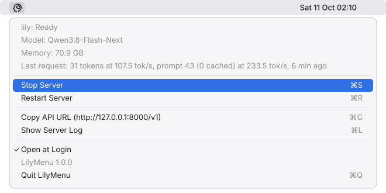
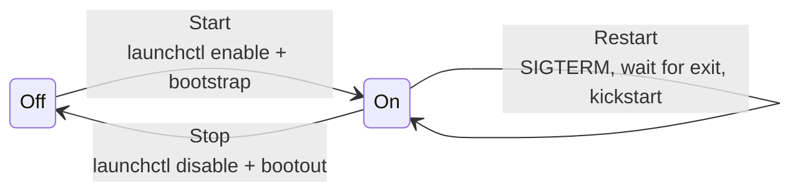

<p align="center">
  
</p>

<h1 align="center">LilyMenu</h1>

<p align="center">
  A menu bar switch for <a href="https://github.com/fabiogreter/lily-qwen3.8-flash-next">lily</a>,
  the Metal inference server for Qwen3.8-Flash-Next on Apple Silicon.<br>
  See whether the model is up, start and stop it, and watch how fast it runs.
</p>

<p align="center">
  <a href="../../releases/latest"><b>Download</b></a> ·
  <a href="#install">Install</a> ·
  <a href="#using-it">Using it</a> ·
  <a href="#building-from-source">Build</a>
</p>

<p align="center">
  
</p>

lily holds about 70 GB of model in unified memory while it runs. LilyMenu puts
that on a switch: one click frees the memory, one click brings the model back
in about 20 seconds, and the icon tells you which state you are in.

## Features

- **Live status** in the menu bar: ready, idle, loading, reloading,
  recovering, stopping, off, waiting for another lily process, or exited with
  an error.
- **Start and stop that stick.** A stopped server stays off across logins; a
  started one comes back at login.
- **Safe restart.** Waits for the old process to release the model's memory
  before the new one starts, so two copies of the model never compete for RAM.
- **What it's doing:** model name, memory footprint, and the last request's
  tokens, decode and prefill speed.
- **One-click API URL** for opencode or any OpenAI-compatible client.
- **Live, highlighted server log** in its own window: follows new lines as
  lily writes them, colors failures, warnings, startup, shutdown and each
  request, and has search and line wrapping.
- **Reads your setup** from the installed launchd plist: a custom `--bind`
  port or log path just works.
- **Native and small:** Swift and AppKit, no dependencies, no Dock icon.
  Every 3 seconds it asks launchd for the job and lily for `/health`.

## Requirements

- macOS 13 or newer on Apple Silicon. lily itself needs an M5 or newer and
  macOS 26.
- lily built and installed as a launchd agent with its
  [`tools/service/lily-service.sh`](https://github.com/fabiogreter/lily-qwen3.8-flash-next/blob/main/tools/service/README.md):

  ```sh
  cd lily-qwen3.8-flash-next
  cargo build --release --locked
  LILY_MODEL=~/models/Qwen3.8-Flash-Next-lily-q4-xl tools/service/lily-service.sh install
  ```

  Until then LilyMenu shows *Service not installed* and links to that guide.

## Install

1. Download `LilyMenu-<version>.zip` from the [latest release](../../releases/latest).
2. Unzip it and move **LilyMenu.app** to `~/Applications` or `/Applications`.
3. Open it. The icon appears in the menu bar, and LilyMenu adds itself to
   your login items (untick **Open at Login** to undo that).

If macOS says it cannot verify the developer, the build is not notarized.
Open **System Settings → Privacy & Security** and click **Open Anyway**, or
clear the download flag once:

```sh
xattr -dr com.apple.quarantine ~/Applications/LilyMenu.app
```

To check a download against its published checksum:

```sh
shasum -a 256 -c LilyMenu-1.0.0.zip.sha256
```

## Using it

### The icon

| Icon | Meaning |
|---|---|
| Filled brain | Ready: the model is loaded and answering |
| Outline brain | Idle: lily unloaded the model after `--idle-unload`; the next request reloads it |
| Grey outline brain | Off, or the service is not installed |
| Hourglass | Starting, loading, reloading or stopping |
| Warning triangle | Recovering, waiting for another lily process to exit, or exited with an error |

### The menu

| Item | What it does |
|---|---|
| **Start Server** / **Stop Server** ⌘S | Turns lily on or off, and keeps it that way across logins |
| **Restart Server** ⌘R | Stops lily, waits for it to exit, starts it again |
| **Copy API URL** ⌘C | Copies `http://<bind>/v1` for OpenAI-compatible clients |
| **Show Server Log** ⌘L | Opens a window that follows lily's log live (see below) |
| **Open at Login** | Whether LilyMenu itself opens at login |
| **Quit LilyMenu** ⌘Q | Removes the icon; the server keeps its current state |

### The log window

Shows the last 512 KB of lily's log (`StandardErrorPath` from the plist),
then each new line as it is written, like `tail -F`. It keeps up when you are
scrolled to the bottom and stays put while you scroll up to read. If the log
is truncated or replaced it starts over from the new file, and if it does not
exist yet the window waits for it.

Lines are colored by what they report, with a tinted band and a stripe at
the left edge:

| Color | Lines |
|---|---|
| Red | Failures: `failed`, `error`, `cannot`, GPU faults, refused requests |
| Orange | Warnings, retries, dropped sessions |
| Green | The model coming up: `listening on`, `loaded`, `ready:` |
| Purple | Going down: `SIGTERM:`, `stopping:`, `stopped`, idle unloads, released pins |
| Blue | One finished request each (`chatcmpl-…:`) |

Within lines, prefixes such as `session cache:` are bold, numbers and their
units stand out, decode rates (`112.1 tok/s`) are green, request IDs blue,
paths teal, and URLs are clickable. Clicking a line highlights it. The
colors follow light and dark mode.

| Key | |
|---|---|
| ⌘F | Find; ⌘G and ⇧⌘G for the next and previous match, ⌘E to search for the selection |
| ⌘A, ⌘C | Select all, copy |
| ⌘W | Close; following stops until the window is opened again |

**Wrap Lines** (on by default, remembered) folds lily's long lines to the
window's width; off, they scroll sideways. **Clear** empties the view without
touching the file. **Show in Finder** reveals `server.log`.

### What Start and Stop do



**On** means the agent is enabled and loaded: launchd runs lily now, restarts
it after a crash, and starts it again at login. **Off** means the agent is
booted out and disabled, so neither a crash handler nor the next login
brings it back. lily gets the same clean shutdown either way: the running
request gets 10 seconds and resident sessions are saved to disk.

Stopping through `lily-service.sh stop` works too; LilyMenu shows it as off
and its Start button starts it again.

### Settings

LilyMenu follows lily's defaults and reads the rest from the plist. Two
settings can be changed from Terminal; quit and reopen LilyMenu afterwards:

```sh
# The launchd label, if you installed lily with LILY_LABEL
defaults write com.lily.menu ServiceLabel com.example.lily

# Seconds between status checks (default 3, minimum 1)
defaults write com.lily.menu PollInterval 5
```

## Troubleshooting

**"Waiting for another lily process to exit".** Only one lily runs at a time.
A server started by hand, `lily-bench` or `lily-probe` holds the instance
lock; launchd retries every 30 seconds and the service comes up once that
process exits.

**"Exited with 1, restarting".** The model failed to load. **Show Server Log**
shows why; a wrong `--model` path is the usual cause. Fix the path, run
`lily-service.sh install` again, then press **Start**.

**The icon stays an hourglass.** The first load reads about 100 GB from disk
and takes around 25 seconds on an M5 Max; a cold disk cache takes longer.

## Building from source

Needs Xcode 16 or newer (Swift 6).

```sh
git clone https://github.com/m8than/lily-menu.git && cd lily-menu
make install      # builds dist/LilyMenu.app, copies it to ~/Applications, opens it
```

| Command | What it does |
|---|---|
| `make build` | Debug build |
| `make test` | Unit tests |
| `make app` | `dist/LilyMenu.app`, ad-hoc signed |
| `make zip` | Also `dist/LilyMenu-<version>.zip` and its `.sha256` |
| `make install` | Builds and installs to `~/Applications` (`PREFIX=` to change) |
| `make uninstall` | Removes the app and its settings |
| `make icon` | Regenerates `Resources/AppIcon.icns` |

### Layout

```
Sources/LilyMenuCore/   launchd and HTTP logic, plist parsing, status rules (tested)
Sources/LilyMenu/       the AppKit status item and menu
Tests/                  unit tests for LilyMenuCore
Resources/              Info.plist template and app icon
scripts/bundle.sh       builds, signs, notarizes and zips the .app
```

## Releasing

1. Bump `VERSION` and add a section for it to `CHANGELOG.md`.
2. Tag and push: `git tag v$(cat VERSION) && git push --tags`.

The [release workflow](.github/workflows/release.yml) runs the tests, builds
the app and publishes the zip, its checksum and the changelog section as a
GitHub release. With the `MACOS_CERTIFICATE`, `MACOS_CERTIFICATE_PASSWORD`,
`CODESIGN_IDENTITY` and `NOTARY_*` secrets set, it signs with your Developer
ID and notarizes, so users skip the Gatekeeper step. Locally,
`CODESIGN_IDENTITY="Developer ID Application: …" NOTARY_PROFILE=<profile> make zip`
does the same.

## License

[Apache License 2.0](LICENSE), like lily. LilyMenu is an independent
companion app and is not affiliated with Perplexity, Qwen or Alibaba.
